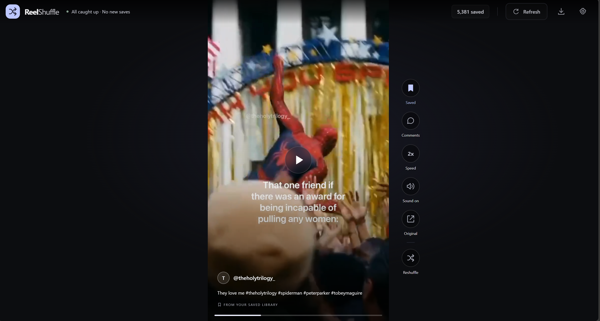

# ReelShuffle

**Your Instagram saved reels, finally watchable again.**

You've saved hundreds (maybe thousands) of reels "for later", and Instagram buries them in an endless grid nobody scrolls. ReelShuffle is a small Chrome extension that turns that pile into a full-screen, shuffled feed, so you actually rewatch what you saved.



## What it does

- **Plays your saved reels as a feed.** Full height, one reel at a time, autoplaying, shuffled.
- **Never repeats until you've seen everything.** It remembers what you've watched, even after you close the tab. Press **Reshuffle** to start fresh.
- **Unsave with one click** when a reel has served its purpose. It leaves your feed instantly; Instagram is updated the next time you press Refresh, and **Undo** is right there if you change your mind.
- **Quick refresh.** Refresh only fetches what you've saved since last time, so it takes seconds even with thousands of saves.
- **Comments, 2x speed, seeking.** Read a reel's comments, play it at double speed, or click and drag the progress bar.
- **Export and import.** Download your whole saved library as a spreadsheet (CSV) or JSON, and load it back any time.

## Setup (about 2 minutes)

You need Chrome (or Edge or Brave) on a computer, and to be logged in to Instagram in that browser.

1. **Download** `ReelShuffle-v1.0.0.zip` from the [Releases page](../../releases/latest) and unzip it.
2. Open **`chrome://extensions`** in Chrome and switch on **Developer mode** (top-right).
3. Click **Load unpacked** and choose the unzipped **`ReelShuffle`** folder.
4. Go to **instagram.com**, open your profile, and click **Saved**. ReelShuffle starts loading your saved reels; a small note in the corner shows progress.
5. Click the **ReelShuffle icon** in your toolbar (pin it from the puzzle-piece menu) and start watching.

That's it. No account, no sign-up, no password.

## Using it

| Action | How |
| --- | --- |
| Next / previous reel | Scroll anywhere, or **↓ →** / **↑ ←** |
| Pause / play | **Space** or click the reel |
| Sound on / off | **M** |
| Unsave | **U** or the bookmark button |
| Comments | **C** or the speech-bubble button |
| 2x speed | **2x** button (turns off on the next reel) |
| Seek | Click or drag the bar at the bottom of the reel |
| Open on Instagram | **Original** button, or click the @name for their profile |
| Get new saves | **Refresh** (top right) |
| Export / import | Download icon (top right) |
| Re-check everything | Settings → **Complete refresh** |

## Private by design

- Everything stays in your browser. There's no server, no tracking, and no analytics.
- It uses your existing Instagram login in Chrome. It never sees or stores your password.
- Videos stream straight from Instagram. Nothing is downloaded or re-uploaded.

## Good to know

- ReelShuffle uses Instagram's own website the same way your browser does, but it isn't an official Instagram product. If Instagram changes something, syncing may stop until the extension is updated; your library stays playable from the local copy.
- Requests are deliberately slow and spaced out. If Instagram ever asks you to slow down, ReelShuffle pauses and tells you, and never retries automatically.
- It's built for personal use with your own account.

## For developers

The extension source lives in [`ReelShuffle/`](ReelShuffle/), and its [technical README](ReelShuffle/README.md) covers the architecture, the Instagram endpoints, permissions and error handling. To run the tests:

```sh
npm install
npm test
```
